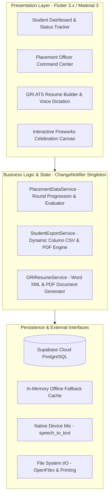
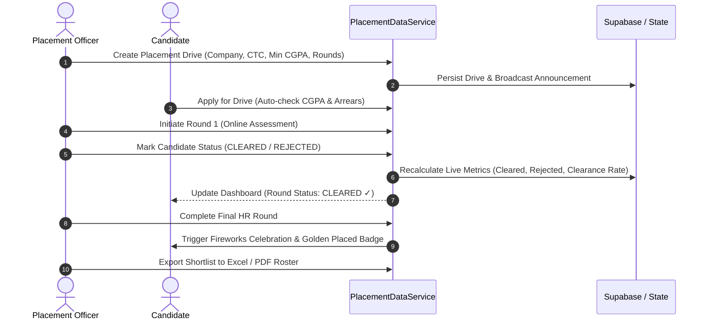

# PLACETRACK: CAMPUS RECRUITMENT & CAREER ENABLEMENT SYSTEM
## Comprehensive Technical Documentation, Architecture, Data Models & Operations Manual

**Institution**: The Gandhigram Rural Institute (Deemed to be University)  
**Ministry**: Ministry of Education, Government of India  
**Location**: Gandhigram - 624 302, Dindigul District, Tamil Nadu, India  
**Application Version**: `1.0.0 (Production Release)`  
**Academic Session**: 2026 – 2027  
**Official PDF Document**: [`PlaceTrack_Project_Documentation.pdf`](file:///c:/projects/placetrack/docs/PlaceTrack_Project_Documentation.pdf)

---

## 1. Executive Summary

**PlaceTrack** is a centralized, multi-tier recruitment and student career progression ecosystem developed specifically for **The Gandhigram Rural Institute (Deemed to be University)**.

Prior to PlaceTrack, placement processes across departments suffered from:
1. **Spreadsheet Fragmentation**: Placement coordinators tracked students via disparate offline Excel sheets, leading to data mismatches and lost status updates.
2. **Slow Round Transition Communication**: Circulars announcing shortlists for subsequent rounds (Aptitude -> Technical -> HR) took hours to publish, causing candidate anxiety.
3. **Resume ATS Rejection**: Many rural students lacked knowledge of Applicant Tracking System (ATS) parsing rules, resulting in automated rejection by top recruiting software.
4. **Lack of Instant Recognition**: Candidate clearance lacked motivation or instant celebration within the portal.

### Core PlaceTrack Solutions:
- **Real-Time Round Evaluation**: Live toggle between `PENDING`, `CLEARED ✓`, and `REJECTED ✕` with real-time recalculation of round metrics.
- **Physics-Based Placement Celebration**: Interactive 120+ particle multi-burst fireworks and firecracker launch engine celebrating final selections.
- **Official GRI ATS Resume Generator with Voice Typing**: Hands-free voice dictation enabling students to generate standard Word (`.docx`) and vector PDF resumes matching official university formats.
- **Granular Custom Column Export**: Allows Placement Officers to select custom data attributes and export to Excel/CSV or print-ready PDF rosters.

---

## 2. Technical Architecture & Technology Stack

PlaceTrack adheres to Clean Architecture principles, ensuring distinct separation of concerns:



### Production Dependency Stack

| Technology / Library | Version | Role in PlaceTrack |
| :--- | :--- | :--- |
| **Flutter SDK** | `^3.13.4` | Cross-platform high-performance UI engine (Android, Web, Desktop) |
| **Dart SDK** | `^3.13.4` | Strongly typed language with null safety for business logic |
| **supabase_flutter** | `^2.17.2` | Cloud database, authentication, and real-time subscription |
| **pdf & printing** | `^3.13.1 / ^5.15.1` | Native vector PDF rendering, printing, and sharing |
| **speech_to_text** | `^7.5.0` | Real-time voice-to-text dictation for resume sections |
| **archive** | `^4.3.0` | Native ZIP packaging for Word `.docx` XML structures |
| **open_filex** | `^4.7.0` | Cross-platform file opening for generated documents |

---

## 3. Data Models Specification

### 3.1 `StudentModel` (`lib/models/student_model.dart`)
Represents an enrolled student within the GRI placement database.
- `id` (`String`): Unique identifier (UUID).
- `name` (`String`): Full name of the candidate.
- `rollNumber` (`String`): Unique university registration identifier (e.g., `23101234`).
- `department` (`String`): Degree and department (e.g., `Computer Science`, `MCA`, `B.Tech`).
- `email`, `phone` (`String`): Contact credentials.
- `cgpa` (`double`): Cumulative Grade Point Average (0.00 – 10.00 scale).
- `historyOfArrears` (`int`): Cumulative backlogs in previous semesters.
- `standingArrears` (`int`): Active, uncleared backlogs.
- `isPlaced` (`bool`): Flag indicating if candidate secured a formal job offer.
- `placedCompany` (`String?`): Recruiter name upon placement clearance.
- `packageLpa` (`double?`): Cost to Company (CTC) compensation in Lakhs Per Annum.
- `clearedRounds` (`List<String>`): List of round IDs successfully completed by the student.

### 3.2 `PlacementDrive` (`lib/models/placement_drive.dart`)
Represents an on-campus or pooled recruitment drive conducted by a visiting corporate partner.
- `id` (`String`): Unique Drive ID.
- `companyName` (`String`): Recruiting corporate entity (e.g., `Cognizant`, `Zoho`, `TCS`).
- `jobRole` (`String`): Designation offered (e.g., `Software Engineer`, `Cloud Associate`).
- `packageLpa` (`double`): Compensation offered.
- `minCgpa` (`double`): Eligibility cutoff score.
- `maxStandingArrears` (`int`): Backlog threshold for candidate eligibility.
- `driveDate` (`DateTime`): Drive execution date.
- `status` (`String`): Current stage (`upcoming`, `active`, `completed`).
- `rounds` (`List<PlacementRound>`): Ordered stages of candidate evaluation.

### 3.3 `PlacementRound` (`lib/models/placement_round.dart`)
Represents an individual stage within a drive.
- `id` (`String`): Unique round identifier.
- `roundNumber` (`int`): Sequence index (1, 2, 3...).
- `name` (`String`): Round designation (`Online Assessment`, `Technical Interview`, `HR Round`).
- `status` (`String`): Stage state (`Pending`, `Active`, `Completed`).
- `roundDate` (`DateTime?`): Scheduled round date.
- `candidateStatus` (`Map<String, String>`): Dynamic mapping associating each `studentId` with status:
  - `PENDING`: Candidate awaiting evaluation.
  - `CLEARED`: Candidate approved and advanced to next round.
  - `REJECTED`: Candidate eliminated from current drive.

---

## 4. End-to-End Recruitment Workflow



---

## 5. Core Feature Deep-Dives

### 5.1 Real-Time Candidate Evaluation Engine
- Located in: [`lib/screens/drive_management_screen.dart`](file:///c:/projects/placetrack/lib/screens/drive_management_screen.dart) and [`lib/services/placement_data_service.dart`](file:///c:/projects/placetrack/lib/services/placement_data_service.dart).
- Officers can quickly toggle between candidates with single-tap evaluation buttons.
- Features a **Live Summary Banner** showing:
  - **Total Candidates**: Total applicants evaluated.
  - **Cleared Candidates**: Successfully passed candidates.
  - **Rejected Candidates**: Eliminated candidates.
  - **Pending Candidates**: Awaiting decision.
  - **Clearance Rate**: Real-time percentage indicator.

### 5.2 Physics-Based Fireworks & Crackers Celebration
- Located in: [`lib/widgets/placement_celebration_dialog.dart`](file:///c:/projects/placetrack/lib/widgets/placement_celebration_dialog.dart).
- Simulates multi-burst radial fireworks using a custom Flutter `CustomPainter`.
- Particles are generated with random velocity vectors, drag resistance, and gravitational acceleration.
- Includes golden shimmer effects, celebratory modals, and persistent **Golden Placed Badges** on the student portal.

### 5.3 Official GRI ATS Resume Builder with Voice Typing
- Located in: [`lib/screens/resume_builder_screen.dart`](file:///c:/projects/placetrack/lib/screens/resume_builder_screen.dart) and [`lib/services/gri_resume_service.dart`](file:///c:/projects/placetrack/lib/services/gri_resume_service.dart).
- Matches the official Gandhigram Rural Institute template standard with tabular education layout.
- Integrates `speech_to_text` for hands-free dictation of Career Objectives and Project Summaries.
- Supports dual export: Native Microsoft Word (`.docx`) and vector PDF.

### 5.4 Custom Column Student Directory & Export
- Located in: [`lib/screens/student_list_screen.dart`](file:///c:/projects/placetrack/lib/screens/student_list_screen.dart) and [`lib/services/student_export_service.dart`](file:///c:/projects/placetrack/lib/services/student_export_service.dart).
- Search across Roll Number, Full Name, Department, and CGPA.
- Filter by Company and Round status (`Cleared Only`, `Rejected`, `Pending`).
- Custom Column Modal allows selecting exact fields to export to CSV/Excel or PDF.

---

## 6. Visual Walkthrough & Screenshots

### 6.1 Authentication Portal

*Figure 1: PlaceTrack Dual Role Authentication (Student & Placement Officer)*

### 6.2 Placement Officer Command Center

*Figure 2: Placement Officer Command Center with Drive Monitoring & Live Statistics*

### 6.3 Official GRI Resume Template vs. Builder
| Official GRI Academic Template | PlaceTrack Interactive Builder |
| :---: | :---: |
|  |  |

### 6.4 Live Mobile Deployment

*Figure 5: PlaceTrack running natively on connected physical Android mobile smartphone*

---

## 7. Build & Deployment Commands

```bash
# 1. Code Quality & Static Analysis
dart analyze lib

# 2. Build Release Android APK
flutter build apk --no-tree-shake-icons

# 3. Direct Mobile Installation via ADB
flutter install -d <device_id>

# 4. Generate Publication-Quality Documentation PDF
dart run scripts/generate_documentation_pdf.dart
```

---

## 8. Document Verification & Sign-off

- **Document Version**: `1.0.0 (Final Release)`
- **PDF Artifact**: [`PlaceTrack_Project_Documentation.pdf`](file:///c:/projects/placetrack/docs/PlaceTrack_Project_Documentation.pdf)
- **Verified by**: Training & Placement Cell, The Gandhigram Rural Institute (Deemed to be University)
- **Status**: Production Deployed & Operating
